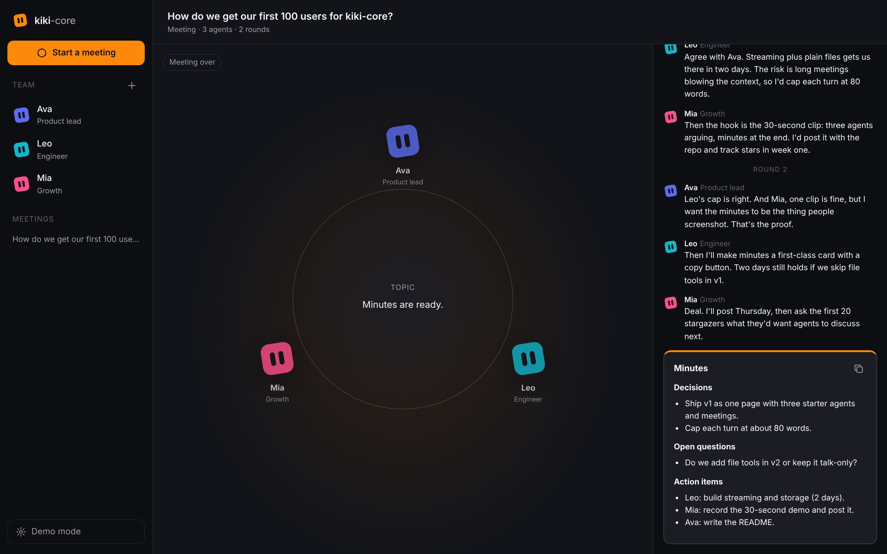

# kiki-core

**A tiny AI team that runs on your computer.** Create a few agents, talk to each one, then call them into a meeting: they take turns, argue, build on each other, and the host writes the minutes.



```bash
npx github:lkyxuan/kiki-core
```

Your browser opens. Paste an API key (DeepSeek, OpenAI, OpenRouter, a local Ollama, or anything OpenAI-compatible) and you're in. No account, no Claude Code, no cloud.

Want to look around first? `KIKI_MOCK=1 npx github:lkyxuan/kiki-core` runs with canned replies and no key.

## What it does

- **Agents.** Each one has a name, a role, a color, how they think, and optionally their own model. It's one Markdown file per agent.
- **One-on-one chat.** Click an agent and talk. Replies stream in.
- **Meetings.** Write a topic, pick who's in the room, choose 1 to 3 rounds. Agents speak in a fixed order around the table, each one sees what the others said. Jump in any time; the next speaker answers you. The host (first agent) ends with minutes: decisions, open questions, action items.
- **Plain files.** Everything lives in `~/.kiki-core/`: `agents/*.md`, `chats/*.json`, `meetings/*.md`. Edit them by hand if you like.

## What it doesn't do

kiki-core is a round table, not a router. There is no "who should handle this" logic, no task splitting, no dispatching work to agents. That orchestration is what powers [Kiki](https://getkiki.ai), the Mac app this project comes from, and it stays there.

## How it works

About 600 lines of plain JavaScript, zero dependencies, Node 18+.

| File | What |
| --- | --- |
| `src/llm.js` | Streams a chat completion from any OpenAI-compatible API with `fetch` |
| `src/meeting.js` | The meeting loop: rounds, turns, interjections, minutes |
| `src/store.js` | Agents, chats, meetings as files |
| `src/server.js` | Local JSON + SSE API on `127.0.0.1` |
| `web/` | The page: no framework, no build step |

## License

[Apache-2.0](LICENSE). "Kiki" and the Kiki logo are trademarks of their owner and are not covered by this license.
